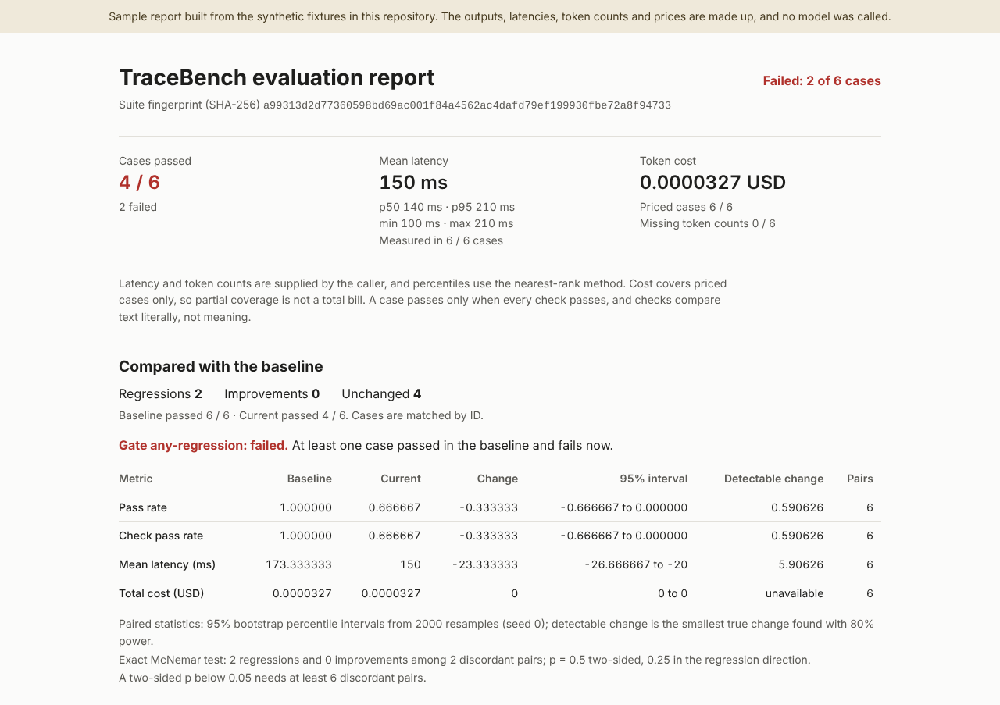

# TraceBench

[](https://github.com/ult666666/tracebench/actions/workflows/ci.yml)

TraceBench checks recorded model outputs against a suite of test cases, so a prompt or model
change can be reviewed before it ships. It joins cases to outputs by ID, runs literal checks,
totals the latency and token cost you recorded, and fails a CI job when the candidate regresses
against a saved baseline. Paired statistics help tell a regression from run-to-run noise.

It runs offline on Python 3.11 or newer, uses only the standard library, and never calls a model
provider.

## Try it

From a checkout:

```sh
python3 -m venv .venv
.venv/bin/python -m pip install --no-index .
mkdir -p reports
.venv/bin/tracebench evaluate --cases fixtures/cases.jsonl --outputs fixtures/baseline.jsonl --pricing fixtures/pricing.json --report reports/baseline.json
.venv/bin/tracebench evaluate --cases fixtures/cases.jsonl --outputs fixtures/clean.jsonl --pricing fixtures/pricing.json --baseline reports/baseline.json --report reports/clean.json
.venv/bin/tracebench evaluate --cases fixtures/cases.jsonl --outputs fixtures/regression.jsonl --pricing fixtures/pricing.json --baseline reports/baseline.json --format html --report reports/regression.html
```

The commands exit 0, 0 and 3. The bundled suite has six English and Mandarin cases with
synthetic outputs, latencies and prices. The clean candidate passes all six, with its outputs in
reverse order to show the join by ID. The last candidate breaks the English greeting and the
Mandarin location check, so TraceBench reports two regressions and exits 3. Open
`reports/regression.html` in a browser, or the [hosted sample](https://ult666666.github.io/tracebench/):



The same report is committed as [HTML](docs/sample-report.html) and as
[Markdown](docs/sample-regression.md).

## Inputs and checks

Cases and outputs are JSONL files, one object per line:

```json
{"id":"greeting","input":"请回答你好","checks":[{"type":"exact","expected":"你好"}]}
```

```json
{"id":"greeting","output":"你好","metrics":{"latency_ms":120.5,"input_tokens":10,"output_tokens":2}}
```

| Check | Passes when |
| --- | --- |
| `exact` | The output equals the expected string, including case, whitespace and Unicode code points |
| `contains` | The output contains a nonempty literal substring |
| `json_subset` | A structured output contains the expected object; arrays keep their length and order, and booleans differ from numbers |

A case passes only when every check passes. Pricing is a separate file with both rates as
decimal strings per million tokens, for example
`{"currency":"USD","input_per_million":"0.10","output_per_million":"0.30"}`. Inputs are
validated strictly: unknown fields, duplicate IDs and non-finite numbers are errors.
[docs/SCHEMAS.md](docs/SCHEMAS.md) has the full contracts.

## Choose a gate

On a nondeterministic system some cases flip between runs even when nothing changed, so failing
on any single regression mostly reports noise. With a baseline, every report includes paired
statistics: an exact McNemar test on the cases that changed status, bootstrap intervals for the
change in pass rate, latency and cost, and the smallest change the suite could detect. `--gate`
chooses what exit 3 means:

| `--gate` | Exit 3 when |
| --- | --- |
| `any-regression` (default) | Any case passed in the baseline and fails now |
| `mcnemar` | The exact two-sided McNemar p-value is below `--alpha` and regressions outnumber improvements |
| `noninferiority` | The pass-rate interval's lower bound is below `-margin`, so the candidate has not shown it is within the margin |
| `confident-regression` | The pass-rate interval's upper bound is below `-margin`, so the drop is confidently larger than the margin |

The paired demo in `fixtures/paired/` has 100 synthetic cases, and its baseline passes 80 of
them:

```sh
.venv/bin/tracebench evaluate --cases fixtures/paired/cases.jsonl --outputs fixtures/paired/baseline.jsonl --pricing fixtures/pricing.json --report reports/paired-baseline.json
.venv/bin/tracebench evaluate --cases fixtures/paired/cases.jsonl --outputs fixtures/paired/noisy.jsonl --pricing fixtures/pricing.json --baseline reports/paired-baseline.json
.venv/bin/tracebench evaluate --cases fixtures/paired/cases.jsonl --outputs fixtures/paired/noisy.jsonl --pricing fixtures/pricing.json --baseline reports/paired-baseline.json --gate mcnemar
.venv/bin/tracebench evaluate --cases fixtures/paired/cases.jsonl --outputs fixtures/paired/regressed.jsonl --pricing fixtures/pricing.json --baseline reports/paired-baseline.json --gate mcnemar --format markdown
```

| Candidate | Pass-rate change (95% interval) | McNemar p | Default gate | `--gate mcnemar` |
| --- | ---: | ---: | --- | --- |
| Noisy: swaps 5 passing and 5 failing cases | 0 (-0.06 to 0.06) | 1 | exit 3 | exit 0 |
| Regressed: breaks 12 cases and fixes 1 | -0.11 (-0.18 to -0.04) | 0.00341797 | exit 3 | exit 3 |

The commands exit 1, 3, 0 and 3; the baseline itself exits 1 because it has failing cases. The
default gate fails the noisy candidate on its 5 regressions, and the McNemar gate does not. At
80% power, this suite can only detect pass-rate changes of about 0.09. That is why
`--gate noninferiority --margin 0.05` rejects even the noisy candidate.

Gates judge pass/fail only, and they assume cases are independent. Suppose 10% of the cases in
an unchanged 100-case suite flip at random. The default gate then fails 99.4% of the time, and
the McNemar gate 1.1%. For small suites, prefer `mcnemar`.
[docs/METHODOLOGY.md](docs/METHODOLOGY.md#paired-statistics-and-gates) has the
formulas, the references and a simulation of each gate's error rates.

## Use it in CI

| Exit | Meaning |
| --- | --- |
| `0` | All checks pass and there is no regression, or a statistical gate passed |
| `1` | Some cases fail, but none regressed (default gate only) |
| `2` | Invalid input, an incompatible baseline, a usage error or an I/O error |
| `3` | A pass-to-fail regression, or a statistical gate failed |

A baseline is a prior JSON report for the same suite. TraceBench checks a fingerprint of the
suite, so changed prompts or checks need a fresh baseline. The
[reusable workflow](docs/CI.md) uploads JSON, Markdown and HTML reports and then applies the
gate; this repository's CI calls it with clean and regressed fixtures. `tracebench policy` adds
optional budgets for pass rate, p95 latency and total cost.
[docs/CLI.md](docs/CLI.md) is the full command reference.

## Docs

- [Command-line reference](docs/CLI.md): options, outputs, exit codes, baselines and budgets.
- [Methodology](docs/METHODOLOGY.md): how each check and statistic is computed, and their limits.
- [Library API](docs/API.md): a complete offline example.
- [CI integration](docs/CI.md): the reusable workflow, its artifacts and what it trusts.
- [HTML reports](docs/HTML.md): the offline report, its security boundary and its browser tests.
- [Architecture](docs/ARCHITECTURE.md): data flow, validation, baseline compatibility, packaging.
- [Verification](docs/VERIFICATION.md): what CI runs on every push, and how to run it locally.
- [中文指南](docs/README.zh-CN.md): 快速运行与结果解释。

## Development

```sh
python3 -m unittest discover -v
```

The tests cover file boundaries, multilingual checks, hand-computed metrics, malformed
baselines, report escaping, exit codes from real subprocesses, and wheel and source-archive
builds. The statistics tests compare exact p-values with hand derivations and brute-force
enumeration, check the bootstrap's invariants over seeded random suites, and measure each
gate's error rates by exact computation and simulation. CI runs them on
Python 3.11 and 3.13, along with the recorded-evaluation gates and a Chromium job for the HTML
report. See [CONTRIBUTING.md](CONTRIBUTING.md) and [SECURITY.md](SECURITY.md).

## Limits

- Checks are literal: there is no judge of meaning, facts, safety or language quality.
- TraceBench uses the latency, token counts and prices you supply; it does not time a provider or
  look up prices, and a cost over partly priced cases is not a total bill.
- The statistical gates assume independent cases, use one recorded run per report, and do not
  correct for running a gate on every push.
- Reports do not keep case inputs or expected values.
- The bundled data is synthetic, and this is a portfolio project that has not been used in
  production.

Built with AI coding assistants. MIT licensed.
